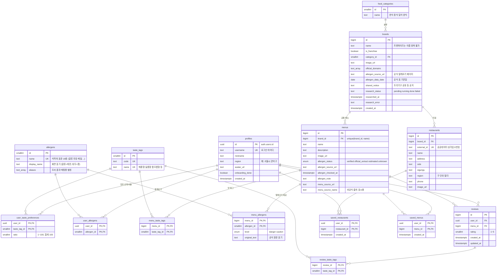

# T:MATE ERD

브랜드 구조 반영본. 구조를 바꾸면 `supabase/schema.sql`(+ 기존 DB 용 `supabase/migrations/`)과 `src/types/database.types.ts` 도 같이 수정한다.

- 지점(`restaurants`)은 공공데이터(소상공인 상가정보)에서 전국 지점을 가져온다.
- 메뉴·알레르기는 브랜드(`brands`) 단위로 한 번만 조사하고, 그 브랜드의 모든 지점이 공유한다. 개인 식당은 가게 1개 = 브랜드 1개(1:1).
- 평가(`reviews`)는 브랜드 메뉴에 붙는다. 알레르기는 식약처 표준 19종, 정보가 없으면 `allergen_status = unknown`.

## 뷰 (테이블 아님, security_invoker)

- `menu_stats`: 메뉴별 평균 별점, 평가 수
- `brand_stats`: 브랜드별 평균 별점, 평가 수 (소속 메뉴 평가). 목록 RPC 는 지점이 많으므로 이 뷰를 브랜드 단위로 조회한다
- `restaurant_stats`: 지점별 평균 별점, 평가 수 (소속 브랜드 메뉴 평가)
- `restaurant_taste_tags`: 지점 카드의 입맛 태그 (소속 브랜드 메뉴 태그의 합집합)

## 알레르기 규칙

- `allergen_status`: `verified`(공식 본문 직접 확인) / `official_extract`(공식 도메인 검색 발췌) / `estimated`(일반 조리법 추정) / `unknown`(정보 없음)
- `menu_allergens.level`: `danger` = 함유(조사 결과의 contains), `caution` = 혼입 가능(may_contain). 정보 없는 메뉴는 행을 만들지 않는다
- 알레르기를 등록한 사용자의 추천에서는 겹치는 메뉴와 `unknown`/`estimated` 메뉴를 제외한다. 등록하지 않았다면 상태와 무관하게 포함한다

## RPC로 계산하는 값 (functions.sql)

- 메뉴·가게 취향 일치도(브랜드 메뉴 기준), 추천 이유 문장, 오늘의 추천 메뉴(브랜드당 한 번, 링크용 대표 지점 반환)
- 입맛 유형 이름 (비율 상위 2개 조합, 예: 매콤달콤)
- 취향 메이트 목록과 수, 마이페이지 활동 수치(저장·평가·메이트)
- 지역 목록(`get_regions`: 지점이 있는 지역별 지점 수)
- 일치도 계산: 평가 수가 적은 사용자는 입맛 비율 × 메뉴 태그, 평가가 쌓이면 유사 사용자 기반
