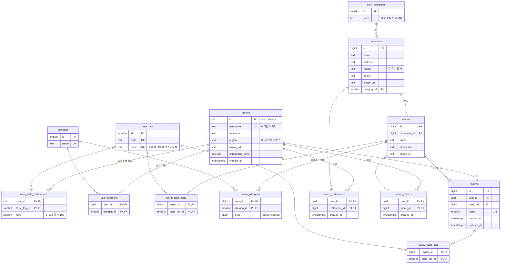

# T:MATE ERD

Figma 디자인(2026-11-23 기준) 반영본. 구조를 바꾸면 `supabase/schema.sql` 과 `src/types/database.types.ts` 도 같이 수정한다.

## 뷰 (테이블 아님)

- `menu_stats`: 메뉴별 평균 별점, 평가 수
- `restaurant_stats`: 가게별 평균 별점, 평가 수 (소속 메뉴 평가의 평균)
- `restaurant_taste_tags`: 가게 카드의 입맛 태그 (소속 메뉴 태그의 합집합)

## RPC로 계산하는 값 (functions.sql)

- 메뉴·가게 취향 일치도, 추천 이유 문장, 오늘의 추천 메뉴
- 입맛 유형 이름 (비율 상위 2개 조합, 예: 매콤달콤)
- 취향 메이트 목록과 수, 마이페이지 활동 수치(저장·평가·메이트)
- 일치도 계산: 평가 수가 적은 사용자는 입맛 비율 × 메뉴 태그, 평가가 쌓이면 유사 사용자 기반
